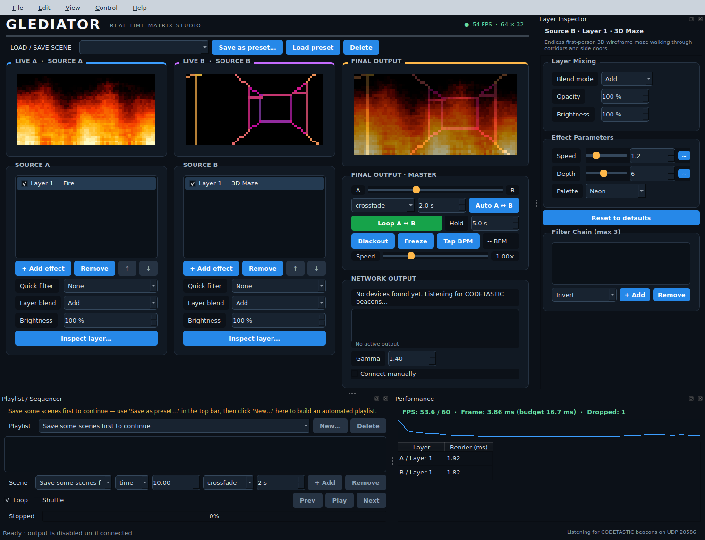

# Glediator Python / Qt6 Studio

A real-time LED matrix visualizer and dual-deck mixer built with Python, NumPy, and PySide6. It pairs a UI-independent rendering core (two 5-layer scenes, 39 built-in effects, parameterised filters, audio beat/BPM modulation, playlist sequencer, undo/redo, and `.gled` projects) with a 24-bit RGB888 WebSocket receiver protocol for ESP32 HUB75 panels (`esp32-firmware/`).



## Download & Quick Start

Pre-built standalone executables (no Python installation required) are published on the [**Releases page**](https://github.com/mrcodetastic/Glediator/releases/tag/v1.0.0) for **Windows** (`.zip`), **Linux** (`.tar.gz`), and **macOS** (`.tar.gz`).

### Run from Source

Requires Python 3.10+.

```bash
python -m venv .venv
. .venv/bin/activate       # Windows: .venv\Scripts\activate
python -m pip install -e .
python main.py
```

Optional extras: `glediator3[osc]`, `glediator3[camera]`.

## Key Features

- **Dual-Deck 5-Layer Mixing:** Source A and Source B with 11 blend modes, per-layer opacity/brightness, 12 parameterised filters (up to 3 chained), docked **Layer Inspector**, **Edit → Copy A to B / Copy B to A / Swap A and B**, dark/light themes, and full undo/redo (`Ctrl+Z` / `Ctrl+Y`).
- **39 Built-in Effects + Plugins:** Generative & procedural patterns (`Fire`, `Falling Snow`, `Starfield`, `3D Maze`, `Plasma`, `Pendulum Wave`, `Noise Smearing`, `Meta Balls`, `Random Pixel`, Aurora patterns, etc.), `Scrolling Text` (cross-platform fonts & palettes), `Image / GIF`, `Video Player` (aspect-preserving fill crop decoded to matrix resolution), `Screen Capture`, optional `Webcam`, and custom plugins from `~/.glediator/effects/`.
- **Live Show Control:** Transition modes (`crossfade`, `cut`, `wipe_*`, `dissolve`, `luma`), one-shot **Auto A ↔ B** or continuous **Loop A ↔ B** with configurable **Hold** time, blackout/freeze/speed master bus, bass/mid/treble & beat/BPM extraction (`VU Meter` with auto-sensitivity, `Spectrum Analyser`), tap tempo, audio/LFO parameter modulation, timed/beat playlists, keyboard shortcuts, built-in **User Guide (`F1`)**, and OSC control.
- **24-bit RGB888 WebSocket Link:** Streams full row-major RGB888 pixels (`(0,0)` to `(W-1,H-1)`) with configurable output **Gamma** over WebSocket port `12345`, UDP `CODETASTIC` discovery (`20586`), size-mismatch protection, `ack` flow control, hardware `Panel brightness`, and delta/RLE compression. Physical panel chaining, virtual layouts, and wiring transforms belong in the ESP32 `ESP32-HUB75-MatrixPanel-DMA` configuration; all connected receivers must share the same logical display dimensions (`File → LED Panel Config…`).

## Documentation

- [User Guide](docs/user-guide.md) *(also accessible in-app via **Help → User Guide…** or `F1`)*
- [WebSocket Protocol (RGB888)](docs/protocol.md)
- [Writing Custom Effects](docs/effects.md)
- [ESP32 HUB75 Firmware](esp32-firmware/README.md)
- [Contributing](CONTRIBUTING.md)

## Development

```bash
pip install -e ".[dev]"
ruff check glediator tests scripts
QT_QPA_PLATFORM=offscreen pytest -q
```
